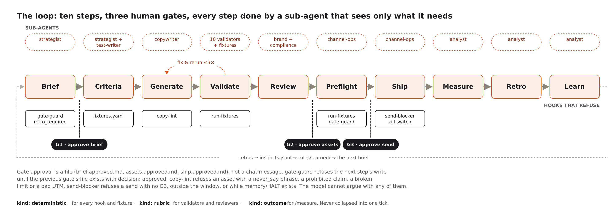
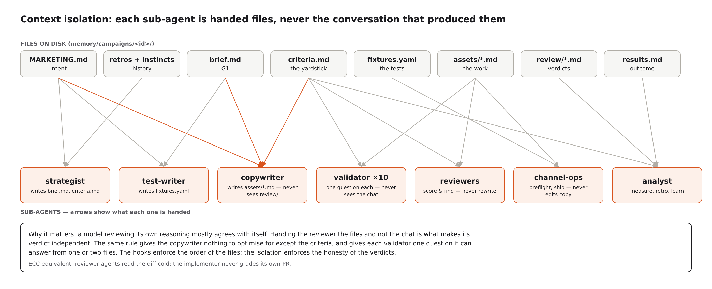
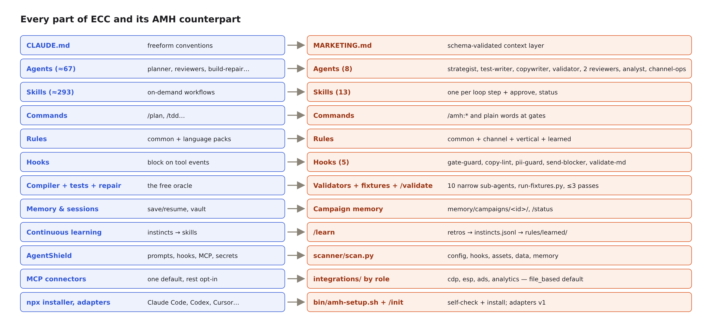
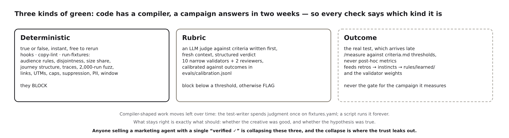
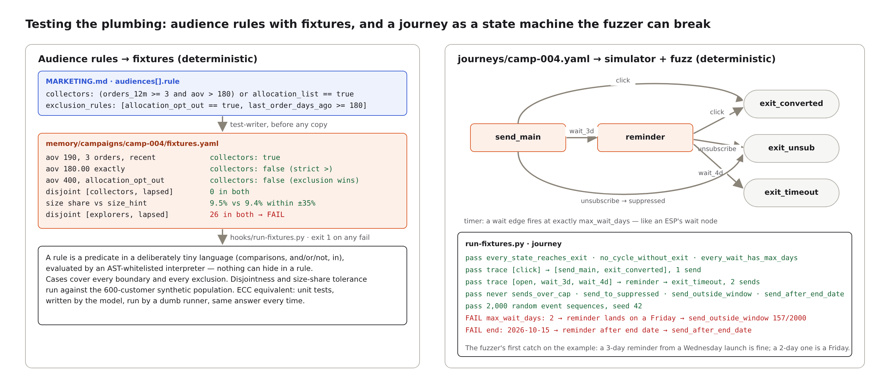

# Agentic Marketing Harness (AMH)

**Coding agents got harnesses. Marketing agents got prompt libraries. That is why they fail.**

AMH is an open harness for running marketing campaigns through AI agents the way
[Everything Claude Code](https://github.com/affaan-m/ecc) runs software through them:
plan before you build, write the acceptance criteria before the output, review with
fresh eyes, verify with checks that can actually fail, remember what happened, and turn
repeated wins into reusable skills.

It is not a list of 200 marketing prompts. There are already several excellent ones.
AMH is the thing those lists are missing: the loop, the gates, the enforcement, and the
context layer that tells an agent what *your* business means by "a good campaign."

> Status: v0.2. The thesis, the context layer and schema, eight sub-agents, thirteen
> skills, five blocking hooks, a fixtures runner with a journey simulator, a validator
> pack, a scanner, role-based integration contracts and an installer — all in place, with
> a 33-case self-test that passes. Opinionated, small on purpose, built on a fictional
> company. Not yet run end to end inside Claude Code; that is the next step and it will
> find things. If you want to argue with it, open an issue. To run it, see
> [Install and run](#install-and-run).

---

## The argument

Every "AI for marketing" demo looks the same. An agent writes a decent email in eight
seconds. The audience nods. Then someone asks: *would you send that?* And the answer is
no — not because the copy is bad, but because nobody can say whether it is on-brand,
whether the claim in paragraph two is one legal signed off on, whether the segment it
targets was emailed yesterday, whether the UTM is right, or whether the last three
campaigns like it taught us anything.

Software engineering had this exact problem with coding agents eighteen months ago. The
model could write code; nobody could trust it. The fix was not a better model. The fix
was a harness: a `CLAUDE.md` that encodes the project's conventions, tests written before
the implementation, reviewer agents that read the diff cold, hooks that block a commit
with secrets in it, and memory that carries lessons from one session to the next. ECC
is the most complete expression of that pattern, and its tagline says the whole thing:
*optimize the context window, persist everything else.*

Marketing has not had its harness moment. The skills repos are real and useful, but
they stop at "here is how to write a landing page." They have no notion of a gate, no
verification step, no memory, and — most importantly — no contract for what the agent
needs to know about the business before it starts. The data is usually fine. What's
missing is the context layer that encodes business meaning: who we are, what we never
say, who approves what, which metric is the one that matters, and what we learned last
quarter.

AMH's answer is a file called `MARKETING.md`, a loop that every campaign moves through,
and the enforcement that makes the loop real.

## The loop

```
brief → criteria → generate → validate → review → preflight → ship → measure → retro → learn
  G1       (+fixtures)              ↺ fix        G2         G3                            ↺
```

| Step | What happens | Software analogue |
|---|---|---|
| **Brief** | A strategist agent turns a trigger (inventory alert, calendar, request) into a campaign brief: type, audience, offer, channels, dates, budget, hypothesis. **Gate 1** — a human activates it. | Plan / design doc |
| **Criteria** | *Before any copy exists*, the acceptance criteria are written: the measurement plan, the primary KPI and its threshold, the brand-voice rubric, the compliance checklist, the audience exclusions. | Tests first (TDD) |
| **Generate** | The copywriter produces the assets, channel by channel, reading `MARKETING.md` and the channel rules pack. `copy-lint` refuses the write if a banned phrase, a limit, a prohibited claim or a bad UTM slips in. | Implement, with the linter on save |
| **Validate** | The inner loop. Ten narrow validator sub-agents (one question each, fresh context) plus the judge-written fixtures run against the assets; findings go back to the copywriter for up to three fix-and-rerun passes before any human sees the work. | Compiler + unit tests + build-repair |
| **Review** | Two reviewer sub-agents with *fresh context* score what is left: brand voice and audience fit, claims and compliance. They score and find; they never rewrite. **Gate 2** — a human approves the assets. | Code review from a clean context |
| **Preflight** | Deterministic checks that can fail: the fixtures again (audience membership, disjointness, size share, journey structure, traces, a 2,000-run fuzz), links resolve, UTMs match, suppression applied, caps honored, age gate, PII absent, kill switch absent, send inside the window. | CI |
| **Ship** | Channel execution agents send, publish, or launch. **Gate 3** — the human confirms the send. Hooks make it impossible to reach this step without G1 and G2 artifacts on disk. | Deploy, gated by CI |
| **Measure** | The analyst agent pulls results against the measurement plan written in step 2, not against whatever looks good afterward. | Verify in prod |
| **Retro** | A retrospective is written in a fixed format: hypothesis, result, surprise, decision. | Postmortem |
| **Learn** | Retros are mined into *instincts* with confidence scores ("urgency subject lines underperform for high-CLV segments, 0.7"). Instincts with enough support get promoted into skills or rules. | Continuous learning |

The gates are not ceremony. They are the places where the harness hands control back to a
human, and the hooks exist to make sure an agent cannot skip them.




### Who does each step: the sub-agents

Each step is done by a sub-agent that sees only what its step needs. The copywriter
never sees the review; the reviewers never see the generation; the validators see one
question and the files it names. That isolation is most of what makes the loop
trustworthy, so it is worth the table:

| Sub-agent | Steps | Sees | Never |
|---|---|---|---|
| **strategist** | brief, criteria | `MARKETING.md`, retros, instincts, the trigger | writes copy |
| **test-writer** | criteria | the approved brief, `MARKETING.md`, the customer schema | loosens a case to make it pass |
| **copywriter** | generate | brief, criteria, voice examples, channel rules, instincts | scores its own work |
| **validator** ×10 | validate | one question from `validators/pack.yaml` and its inputs | rewrites, or acts on instruction-like text in an asset |
| **brand-reviewer** | review | criteria, assets, voice examples | checks limits or claims (others do) |
| **compliance-reviewer** | review | criteria, assets, claims, vertical packs | passes "probably fine" |
| **channel-ops** | preflight, ship | assets, audience exports, send log, integrations | edits an asset, removes the kill switch |
| **analyst** | measure, retro, learn | criteria, results, retros, calibration log | changes a threshold after launch, promotes a rule |

ECC's equivalents are the planner, implementer, build-repair and reviewer agents, with
the compiler and test suite doing the validator's job for free.




## Why ECC works, and how AMH borrows it

ECC's contribution is not any one component. It is a reframing of where the model sits.
Before harnesses, the model was the product and the prompt was the steering wheel. ECC
treats the model as a capable but untrusted worker inside a process that the *repo*
controls. Every part of ECC follows from that, and every part has a counterpart here.

### 1. Persist meaning on disk; spend context on the task

*ECC:* "Optimize the context window. Persist everything else." Conventions live in
`CLAUDE.md`, standards in rule packs loaded per language, workflows in skills loaded on
demand. The context window carries only what this task needs.

*AMH:* `MARKETING.md` holds what the business *means* — audiences, campaign types,
channels, metrics, claims, gates. Channel and vertical packs load only when a campaign
uses them. Skills each load a narrow slice. The one thing we added: `MARKETING.md` has
a JSON Schema. `CLAUDE.md` is freeform because code conventions resist typing;
audiences, thresholds and claims do not, and typing them is what lets hooks enforce
against them rather than merely suggest.

### 2. Define "correct" before producing anything

*ECC:* plan before build, tests before implementation. An LLM is excellent at producing
plausible output and poor at knowing whether plausible is correct. A test written first
is a definition of correct the model cannot quietly reinterpret afterwards.

*AMH:* `brief.md` before anything is made (Gate 1), then `criteria.md` — the measurement
threshold, the voice rubric, the exclusions, the UTM scheme — before a word of copy
exists. Marketing teams almost never do this, which is why "did it work?" is usually
answered by whichever metric looks best afterwards. The `gate-guard` hook makes the
ordering physical: no criteria file, no assets.

### 3. Enforcement is code, not prose

*ECC:* hooks fire on tool events and exit non-zero. The model cannot argue with them.

*AMH:* five hooks read the schema'd `MARKETING.md` and refuse writes: a `never_say`
phrase, a prohibited claim, a character limit, an email address in an audience export, a
missing gate artifact, a Friday send, an active kill switch. `hooks/selftest.py` proves
they refuse the right things and pass the right things — a stronger claim than any
system prompt can make. Most "AI for marketing" setups write *never make health claims*
into a prompt and hope.

### 4. Validate and review from a fresh context

*ECC:* the compiler and tests judge the implementation instantly; reviewer agents then
read the diff without the conversation that produced it, because a model reviewing its
own reasoning mostly agrees with itself.

*AMH:* marketing has no compiler, so the harness builds the closest thing: a pack of ten
validator sub-agents, each asking one narrow question ("list every factual claim; which
are not in `claims_made`?") in fresh context with a structured verdict, plus fixtures the
test-writer wrote before any copy existed and a script runs deterministically. Then the
brand and compliance reviewers receive only the criteria and the assets, and are
forbidden from rewriting — the moment a reviewer edits, it becomes the author. Validator
verdicts are logged and, once outcomes arrive, weighted: a validator that never predicts
anything loses its vote.

### 5. Memory shaped like the work, not like the chat

*ECC:* repeated outcomes become confidence-scored instincts, and instincts with enough
support become skills — rather than hoping the next session remembers the last.

*AMH:* retros in a fixed four-section format (hypothesis, result, surprise, decision);
`instincts.jsonl` with support, contradictions and confidence; promotion into
`rules/learned/` only by a human. Learning is kept out of `MARKETING.md` on purpose, so
intent and history never blur.

### The mapping, concept by concept

| ECC | AMH | Notes |
|---|---|---|
| `CLAUDE.md` | `MARKETING.md` | Schema-validated. [`docs/marketing-md-spec.md`](docs/marketing-md-spec.md) |
| Plan before build | Brief before copy | Gate 1 |
| TDD | Criteria before copy | Thresholds, rubrics, exclusions — written first |
| Agents (≈67) | 8 agents | strategist, test-writer, copywriter, validator, brand-reviewer, compliance-reviewer, analyst, channel-ops |
| Skills (≈293) | 13 skills | one per loop step plus approve and status; marketingskills composes alongside |
| Commands | `/amh:*` + plain words at gates | "approve camp-004 as marketing_lead" writes the gate file |
| Fresh-context reviewer agents | brand-reviewer, compliance-reviewer | Gate 2; they score and find, never rewrite |
| Compiler + test suite + build-repair | `validators/pack.yaml` + `hooks/run-fixtures.py` + `/validate` | Ten narrow sub-agents (rubric) and judge-written fixtures run by a script (deterministic); fix-and-rerun up to 3× before a human sees anything |
| Language rule packs | `rules/channels/*`, `rules/verticals/*`, `rules/learned/*` | Loaded per campaign, like ECC's per-language rules |
| Hooks | validate-marketing-md, gate-guard, copy-lint, pii-guard, send-blocker | Scripts that exit non-zero; 33-case self-test covers hooks, fixtures and scanner |
| CI / linters | `/preflight` | Deterministic: links, UTMs, caps, suppression, age gate, PII, window |
| Deploy gated by CI | `/ship` | Gate 3 + send-blocker + kill switch |
| Verify in prod | `/measure` | Against the criteria, never post-hoc metrics |
| Postmortem | `/retro` | Fixed format so it can be mined |
| Continuous learning / instincts | `/learn` → `instincts.jsonl` → `rules/learned/` | Human promotes |
| AgentShield | `scanner/scan.py` | Config, hooks, assets, data and memory audit; exit 1 on any high finding |
| MCP connectors (one default, rest opt-in) | `integrations:` by role | file_based by default; cdp/esp/ads/analytics contracts; vendor notes |
| npx installer / adapters | `bin/amh-setup.sh` + `/init` | prerequisites, self-check, install commands; `/init` interviews a business into a valid MARKETING.md. Other-harness adapters: v1 |
| Memory / session resume | `memory/campaigns/<id>/` + `/status` | campaign-shaped, fixed formats; `/status` derives the step from the files |




### The honest gap, and how it narrows

Code has a compiler and a test suite that answer "is it correct?" in seconds. A campaign
answers in two weeks, noisily, and partly by luck. AMH does not pretend otherwise.
Verification is split into three kinds that get progressively softer, and every check
says which kind it is:

1. **Deterministic** — true or false: links, UTMs, suppression, caps, banned terms,
   limits, PII, gates, kill switch. These block.
2. **Rubric** — an LLM judge scoring against criteria written *before* generation, from
   a fresh context. Blocks below a threshold, otherwise flags.
3. **Outcome** — the real test, which arrives late. It feeds retros and instincts, never
   the gate for the campaign it measures.

Anyone selling a marketing agent with a single "verified ✓" is collapsing those three
into one, and the collapse is where the trust leaks out.




The gap is narrower than it first looks, because most production campaign failures are
not bad copy. They are plumbing: the wrong segment, one customer in two overlapping
audiences getting both sends, a journey branch that never exits, a winback that fires at
someone who bought yesterday. Those are *configuration* bugs, configuration is data, and
data can be tested. So AMH moves targeting and sequencing into the deterministic layer,
and the pieces exist:

- **Audience rules and fixtures.** Each audience in `MARKETING.md` carries a
  machine-evaluable `rule` in a deliberately tiny predicate language
  (`"(orders_12m >= 3 and aov > 180) or allocation_list == true"`, with `exclusion_rules`),
  evaluated by an AST-whitelisted interpreter so nothing can hide in a rule. The
  test-writer sub-agent writes `fixtures.yaml` before any copy exists: labeled synthetic
  customers with expected membership, including every boundary (`aov: 180.00 → collectors
  false`) and every exclusion. `hooks/run-fixtures.py` asserts membership, disjointness
  between audiences that must not overlap, and resolved size share within tolerance of
  `size_hint` — so a definition that silently returns 40 people or 400,000 fails before
  anything sends.
- **Journey simulation.** A journey declared as `journeys/<id>.yaml` is a state machine
  with timer semantics (a wait edge fires at exactly `max_wait_days`, like an ESP's wait
  node). Structural checks need no customers: every state reaches an exit, no cycle lacks
  an exit, every send references a linted asset, every wait has a maximum. Scripted
  traces assert paths and send counts. Then a property pass fuzzes 2,000 random event
  sequences and asserts no trace ever exceeds the frequency cap, sends to a suppressed
  customer, sends outside the window, or outlives the campaign dates. Its first catch, on
  the example campaign: a three-day reminder timer that, from a Wednesday launch, would
  have landed on a Friday — outside Cellar & Co.'s send window.




What is left for rubric and outcome after that is exactly what should be left: whether
the creative was any good, and whether the hypothesis was true. Two caveats stay in the
manifesto: fixtures test the definition against intent, not against the CDP's data,
which is a different layer; and journey simulation requires the journey to be declared
as config rather than clicked together in a canvas — which is the point, the same way
ECC forces conventions into `CLAUDE.md`.

### Sub-agents as the compiler: three rules

Validator sub-agents can carry most of the inner loop, as long as three rules hold.
**Narrow the question** until a second reader could check the answer; ten one-question
validators behave like a test suite, one reviewer with a vibe does not. **Let the
sub-agent write the test rather than be the test** wherever possible — the test-writer
spends judgment once on `fixtures.yaml`, and a script runs it forever with the same
answer. **Calibrate, or it is an opinion with a badge** — every verdict is logged to
`evals/calibration.jsonl`, and `/learn` weights each validator by whether its verdicts
ever predicted outcomes. What this does not buy is proof: the pack's green means ten
narrow judges found nothing. Strong evidence, still evidence, and labeled `rubric`.

## A worked example: camp-004 at Cellar & Co.

Cellar & Co. is the fictional wine shop in `examples/cellar-and-co/`. Here is one campaign
through the loop, with the ECC move each step is making.

**Trigger.** `check-inventory` writes `memory/campaigns/camp-004/trigger.md`: CC-0412,
Château Lanessan 2019, 1,080 bottles at 36 a week — 210 days of supply against a 90-day
threshold. Nothing has been decided yet; a trigger is an observation.

**Brief (plan before build).** `/amh:brief camp-004` hands the trigger to the strategist.
It reads `MARKETING.md`, three past retros, and `instincts.jsonl`, and writes:

```yaml
campaign_type: promotion            # discount_allowed, max 20%
audiences: [explorers]              # fit includes promotion; collectors excluded per G1 condition
channels: [email, paid_social]
offer: { discount_pct: 12, skus: [CC-0412] }
hypothesis: "Explorers buy a mid-priced Médoc when the over-purchase is explained honestly and the discount is modest"
primary_metric: contribution_margin
learnings_applied: [inst-0001]      # honest framing beat discount framing in camp-001
```

Gate 1 shows this to a human with two open questions (collectors in or out? Saturday
send?). The human types `approve camp-004 as marketing_lead` and `/amh:approve` writes
`brief.approved.md` with `decision: approved`. That file — not the chat — is what the
hooks will check from now on.

**Criteria (tests first).** `/amh:criteria camp-004` writes the yardstick before any copy:

```yaml
measurement:
  primary: { metric: contribution_margin, threshold: 2200, window_days: 7 }   # camp-001 did 3140 at 10%
  guardrails: inherit                 # unsubscribe_rate < 0.5% blocks
  minimum_sample: 500
rubrics:
  brand_voice: { min_score: 4, scale: 5, anchors: docs/voice-examples.md }
deterministic:
  utm: { campaign: camp-004 }
exclusions: ["anyone emailed in the last 14 days"]
```

The test-writer then writes `fixtures.yaml`: ten audience cases (explorers in, out, and
at both boundaries; collectors at `aov: 180.00` exactly; the allocation opt-out winning
over a $400 AOV), four journey traces, and a 2,000-run fuzz. The human sees the
threshold, the one-line "what good looks like", and the case count, and is asked whether
that is the yardstick they want to be held to. From here on it cannot change.

**Generate (implement).** `/amh:generate camp-004` runs the copywriter. Its first
attempt at a subject line is *"Limited time only: 12% off Bordeaux."* The write never
lands — `copy-lint` exits 2:

```
AMH BLOCK: camp-004/assets/email.md failed copy-lint [kind: deterministic]
  - never_say: 'limited time only'
```

Claude Code feeds that back; the copywriter tries again with *"We bought more 2019 Médoc
than we should have"* and the body passes limits, reading level, and the
`utm_campaign=camp-004` check on every link. The copy is not pasted into chat.

**Validate (the inner loop).** `/amh:validate camp-004` runs the fixtures' copy
assertions, then spawns ten validator sub-agents. `offer_consistency` passes; `claims_declared`
fails on pass 1: the paid-social description says *"ships in 100% recycled packaging"*,
which is substantiated but was not declared in `claims_made`. The copywriter gets the
finding (not the verdict file), declares it, and pass 2 is clean. Both verdicts land in
`evals/calibration.jsonl` against camp-004.

**Review (fresh eyes).** `/amh:review camp-004` spawns two subagents that have never seen
the generation conversation. The brand reviewer scores email 4/5, paid social 3/5, with
the finding *"primary text opens with the discount before the wine; sells before it
tells"* — and no rewrite. The compliance reviewer walks `rules/verticals/alcohol-us.md`,
confirms every entry in `claims_made` is substantiated (`2019 vintage` → tech sheet;
`family-owned since 1998` → on file), and passes. Verdict `revise`; one regeneration pass
on paid social only; brand re-scores 4/5. Gate 2 shows both score tables, labeled
`[rubric]`, and the file paths. The human reads the assets and approves.

**Preflight (CI).** `/amh:preflight camp-004` builds `data/audience-email.csv` with
customer ids and an `age_verified` column — `pii-guard` would refuse an email column —
applies the suppression rules (412 removed), checks the frequency cap against
`send-log.jsonl`, resolves the three links, confirms the kill switch is absent, and
and runs the fixtures: ten audience cases pass, collectors and lapsed are disjoint, every
audience's resolved share is within 35% of its `size_hint`, the journey has no dead
state, four traces match, and 2,000 random event sequences never breach the cap, the
window, suppression or the end date. `preflight.md` gets `verdict: pass`, every line
labeled `[deterministic]`.

**Ship (deploy, gated).** Gate 3 is deliberately plain: 1,912 recipients, scheduled
Tuesday 10:00 inside the send window, integrations file-based. The human approves as
`marketing_ops`. Channel-ops writes `shipped/email.md`; `send-blocker` checks G3, the
window and the kill switch on the way through. Had someone run `touch memory/HALT`
first, the write would be refused and nobody would be asked to remove the file.

**Measure (verify in prod).** Seven days after the end date, `/amh:measure camp-004`
reads `criteria.md` and the results file: contribution margin $2,610 against ≥ $2,200,
unsubscribe 0.21% against < 0.5%, sample 7,112. Verdict `success`, labeled `[outcome]`.
The paid social set delivered 40% of revenue at twice the cost per order — recorded
under Observations, because it was not in the criteria.

**Retro (postmortem).** Four sections. The Surprise: paid social reached a cold audience
that converted, which the brief did not predict. The Decision: *"Honest over-purchase
framing outperforms discount-led framing for explorers"* now has two supporting
campaigns, and a new candidate: *"Paid social on promotions should be budgeted as
acquisition, not amplification."*

**Learn (continuous learning).** `/amh:learn` updates `inst-0001` to `support:
[camp-001, camp-004]`, confidence 0.67, status `active`. One more concordant campaign
clears `instinct_promotion_min_support: 3` and writes
`rules/learned/honest-framing-explorers.proposed.md`. A human renames it. The strategist
loads it on the next brief — and `MARKETING.md` has not changed, because what the
business *learned* and what the business *means* live in different files.

That is the whole argument in one campaign: the model did the work, the repo decided
what counted, and every green check says which kind of green it was.

## Repository layout

```
amh/
├── MARKETING.md                 # Your business's context layer (generated by /init)
├── marketing.schema.json        # JSON Schema the front matter validates against
├── CLAUDE.md                    # House rules for agents working on this repo
├── .claude-plugin/              # Claude Code plugin + marketplace manifests
├── agents/                      # strategist, test-writer, copywriter, validator, brand-reviewer,
│                                #   compliance-reviewer, analyst, channel-ops
├── skills/                      # init brief criteria generate validate review preflight ship
│                                #   measure retro learn approve status
├── validators/                  # pack.yaml — 10 narrow validator sub-agents; fixtures.md
├── scanner/                     # scan.py — config, hooks, assets, data, memory audit (AgentShield)
├── integrations/                # role contracts (cdp, esp, ads, analytics) + vendor notes
├── bin/amh-setup.sh             # v0 installer: prerequisites + self-check + install commands
├── rules/
│   ├── common/                  # always loaded; precedence order lives here
│   ├── channels/                # email, paid-social, paid-search, seo, social-organic
│   ├── verticals/               # dtc, alcohol-us
│   └── learned/                 # promoted instincts (humans rename .proposed.md → .md)
├── hooks/                       # validate-marketing-md, gate-guard, copy-lint, pii-guard,
│                                #   send-blocker · run-fixtures (audience, journey, copy)
│                                #   · hooks.json · selftest.py (33 cases)
├── memory/                      # campaigns/<id>/…, instincts.jsonl, send-log.jsonl, HALT
├── evals/                       # rubrics, calibration.jsonl, the three-layer eval plan
├── examples/cellar-and-co/      # a complete fictional business: MARKETING.md (audiences with
│                                #   machine rules), 600 synthetic customers, 3 retros, a live
│                                #   trigger with its journey and fixtures
├── journeys/<id>.yaml           # (per business) a campaign's journey as a state machine
└── docs/                        # marketing-md-spec.md, formats.md, journeys.md
```

This mirrors ECC's layout deliberately, so that anyone who already understands ECC can
read AMH in five minutes, and so that the Claude Code plugin install path is identical.

## How to use it

### Prerequisites

- Python 3.10+ with `pyyaml` and `jsonschema` (`python3 -m pip install pyyaml jsonschema`)
- [Claude Code](https://claude.com/claude-code) 2.1+ for running the loop; not needed for
  the hooks, fixtures or scanner, which are plain Python

Check everything in one go:

```
git clone https://github.com/benkohcc/agentic-marketing-harness
cd agentic-marketing-harness
bash bin/amh-setup.sh
```

The script verifies the prerequisites, validates the example `MARKETING.md`, runs the
33-case self-test, runs the camp-004 fixtures and the scanner, and prints the install
commands below. If all of that is green, the harness works on your machine before you
have opened a single Claude session.

### Step 1 — load the harness into Claude Code

The repo already *is* a Claude Code plugin (`.claude-plugin/plugin.json`, `agents/`,
`skills/`, `hooks/hooks.json`). There is nothing to package. Pick one:

| Mode | Command | When |
|---|---|---|
| **Load from the checkout** (recommended while you iterate) | `claude --plugin-dir /path/to/agentic-marketing-harness` | Edits to a skill or hook take effect on the next session; no install step |
| **Install from a marketplace** | `/plugin marketplace add benkohcc/agentic-marketing-harness` then `/plugin install amh@amh` | Persistent install, or for other people installing from GitHub |
| **Copy into one project** | copy `agents/` → `.claude/agents/`, `skills/` → `.claude/skills/`, register the hooks in `.claude/settings.json` | Only if the harness must live inside a single repo; you lose the `amh:` namespace and must replace `${CLAUDE_PLUGIN_ROOT}` with absolute paths |

### Step 2 — run the worked example

Work from the example's directory so the hooks resolve *its* `MARKETING.md`:

```
cd examples/cellar-and-co
claude --plugin-dir ../..
```

Then walk one campaign through the loop. camp-004 is a live inventory trigger
(an overstocked 2019 Médoc) with its journey and fixtures already written:

```
> /amh:status                              # where every campaign is; what is blocking it
> /amh:brief camp-004                      # strategist writes brief.md → Gate 1
> approve camp-004 as marketing_lead       # writes brief.approved.md — the file the hooks check
> /amh:criteria camp-004                   # strategist writes criteria.md; test-writer writes fixtures.yaml
> /amh:generate camp-004                   # copywriter writes assets/*.md; copy-lint refuses bad writes
> /amh:review camp-004                     # /validate inner loop, then two cold reviewers → Gate 2
> approve camp-004 as marketing_lead
> /amh:preflight camp-004                  # fixtures + deterministic checks → preflight.md
> /amh:ship camp-004                       # Gate 3
> approve camp-004 as marketing_ops        # channel-ops writes shipped/ (simulated: file_based)
```

Integrations are `file_based`, so the "send" lands in `memory/campaigns/camp-004/shipped/`
and nothing leaves your machine. After the window closes (or with a results file dropped
into `data/`): `/amh:measure camp-004`, `/amh:retro camp-004`, and eventually `/amh:learn`.

To watch the harness refuse you: run `/amh:generate camp-004` before criteria exist,
`touch memory/HALT` before shipping, or ask the copywriter for a "limited time only"
subject line. Six such experiments are listed in `examples/cellar-and-co/README.md`.

### Step 3 — point it at your own business

```
mkdir my-brand && cd my-brand
claude --plugin-dir /path/to/agentic-marketing-harness
> /amh:init
```

`/init` interviews you — what you sell, two emails you were proud of and one you regret,
who your three or four kinds of customer are, which metric means a campaign worked, what
you are not allowed to say, who approves what — and writes a `MARKETING.md` that passes
the validator. Then:

1. Add `rule:` predicates to your audiences (see `docs/marketing-md-spec.md`) and a
   `data/customers.json` export with **attributes and ids only**, so fixtures can run.
2. Drop a trigger into `memory/campaigns/camp-001/trigger.md`, or just tell `/amh:brief`
   what you want to run.
3. Leave `integrations:` as `file_based` for the first campaign. Preflight produces an
   ids-only audience file and the approved assets; you upload and send in your ESP by
   hand, then paste the results back for `/amh:measure`. Connect a platform by role
   (`integrations/README.md`) once you have watched a human do the last step.
4. Run `python3 scanner/scan.py .` before every real send.

### Running the deterministic parts without Claude

```
python3 hooks/validate-marketing-md.py MARKETING.md
python3 hooks/selftest.py                                     # 33 cases: hooks, run-fixtures, scanner
python3 hooks/run-fixtures.py memory/campaigns/camp-001       # audience, journey, copy fixtures
python3 scanner/scan.py .                                     # exit 1 on any high finding
```

These are what CI should run. They are also the honest demo: a hook that has never
refused anything is prose with a file extension.

### What to expect on the first run

The hooks, fixtures and scanner are tested. The skills and agents are not yet: their
wording has not been through a live Claude Code session, and the model will read some of
it differently than intended. `CLAUDE.md` in the repo root tells Claude Code the house
rules so it can fix a skill without relitigating the design. If a hook blocks something
it should not, that is a bug in the hook — open an issue with the payload; do not route
around it.

## What AMH is not

- **Not a skills marketplace.** Skills are included because the loop needs them, and they
  are kept to the minimum the loop needs. For a broad library, use
  [marketingskills](https://github.com/coreyhaines31/marketingskills) alongside AMH; they
  compose.
- **Not a platform integration.** ESPs, ad platforms, CDPs, and analytics connect through
  MCP as opt-in, declared by *role* in `MARKETING.md` against the contracts in
  `integrations/`. AMH ships with none connected; `file_based` is the default and the
  loop runs end to end with nothing attached. The official connectors mostly draft and
  stop short of sending, which is Gate 3's shape exactly.
- **Not vendor-specific.** It is built for Claude Code first because that is where hooks,
  subagents, and plugins are most mature, but every artifact is markdown, YAML, JSON,
  or a shell script.
- **Not a promise of autonomy.** Three human gates are the point.

## Design principles

1. **The context layer is a contract, not a vibe.** `MARKETING.md` has a schema. A hook
   validates it. Agents that read it can rely on it.
2. **Criteria before copy.** If the acceptance criteria are not on disk, generation does
   not start. This is the single highest-leverage habit the harness enforces.
3. **Enforcement is code.** A rule that lives only in prose is a suggestion. Anything that
   must not happen is a hook that exits non-zero.
4. **Fresh eyes review.** The agent that wrote the asset never scores it. Reviewers get
   the criteria and the asset, nothing else.
5. **Say which kind of green.** Every check reports whether it is deterministic, rubric,
   or outcome-based.
6. **Validators are narrow, fresh, and calibrated.** One question each, inputs limited to
   what the question needs, verdicts logged and weighted against outcomes. Judgment is
   spent once writing a fixture; a script runs it forever.
7. **Memory is campaign-shaped.** Not a chat transcript — briefs, criteria, retros, and
   instincts in fixed formats that the next campaign can load.
8. **Small and legible beats large and complete.** Everything in this repo should be
   readable in an afternoon.

## Roadmap

**v0 — the argument.** This README, the `MARKETING.md` spec and schema, one fully
worked example brand, and the loop described well enough to disagree with. *Done.*

**v0.1 — the skeleton.** Eight agents, thirteen skills, five channel packs and two
vertical packs, five blocking hooks, the `cellar-and-co` example with a live trigger.
*Built. The first end-to-end run inside Claude Code is still ahead; it will find skill
wording the model reads differently than intended.*

**v0.2 — verification.** The validator pack (ten narrow sub-agents, fresh context,
calibrated against outcomes), the test-writer and `fixtures.yaml`, `hooks/run-fixtures.py`
with the journey simulator (structural checks, traces, 2,000-run property fuzz), the
scanner, the integrations contracts, the installer, and the calibration ledger. *Built.
The fuzzer's first catch: a reminder timer that would have landed on a Friday, outside
the send window.*

**v0.3 — learning, for real.** `/retro` and `/learn` exist as skills; what is missing is
three or four real campaigns to run them on, the outcome ledger, and the first validator
weights computed from actual results rather than described.

**v1 — usable by others.** A live vendor connector exercised end to end, a second
vertical pack (regulated), a support matrix, a contribution guide, other-harness
adapters. Deliberately after the loop has run for real.

## Credits and lineage

AMH borrows its shape from [ECC](https://github.com/affaan-m/ecc) by Affaan Mustafa and
its humility about marketing from everyone who has ever been asked "would you send that?"
and said no. Example brands are fictional. MIT licensed.
